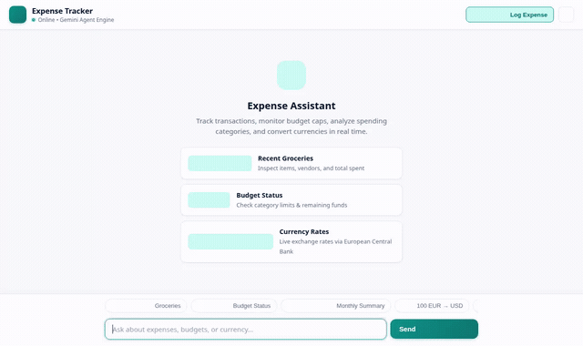

# 💰 Expense Tracker Agent

An intelligent, agent-first personal money manager built with the **Google Agent Development Kit (ADK)**, **Gemini 3.8 Flash**, and **Google Cloud Agent Platform**. It tracks spending across multiple payment methods, audits budget caps, converts currencies, generates spending visuals, and renders rich interactive cards via the **Agent-to-UI (A2UI)** protocol.



---

## 🌟 What the Agent Does

- **Expense Logging**: Records detailed transactions with merchant name, amount, spending category, payment method (Credit Card, Debit Card, Cash, Bank Account), date, and notes.
- **Transaction Auditing**: Retrieves and filters historical expenses by category or payment method, sorted chronologically.
- **Spending Aggregations**: Computes total expenditure, transaction counts, and category/payment method distributions.
- **Budget Health Auditing**: Compares current spending against category caps (e.g., Groceries, Food & Dining, Utilities, Transportation, Entertainment) and assigns health indicators (*Healthy*, *Warning*, or *Over Budget*).
- **Live FX Currency Conversion**: Converts amounts in real time between major world currencies (USD, EUR, GBP, JPY, CAD, etc.) using live European Central Bank market rates.
- **Visual Image Generation**: Creates custom spending illustrations, category icons, and milestone graphics using Gemini image generation, automatically published to Google Cloud Storage.
- **Safe Code Execution**: Executes Python code inside an isolated Agent Engine Sandbox to perform mathematical aggregations and financial projections.
- **A2UI Rich Surfaces**: Formats responses into structured A2UI cards (`Card`, `Column`, `Row`, `Text`, `Image`) rendered directly in the custom web UI.

---

## 🏗️ Architecture & Wired Google Cloud Services

The agent is wired directly into the following Google Cloud and ADK services:

| Service / Capability | Implementation in Code | Role |
|---|---|---|
| **Google Cloud Firestore** | `google.cloud.firestore.Client` in `app/tools.py` | Primary persistent document store for the `expenses` collection |
| **Google Cloud Storage** | `google.cloud.storage.Client` in `app/tools.py` | Public bucket storage hosting generated spending visuals and media assets |
| **Vertex AI Image Generation** | `gemini-3.1-flash-lite-image` via `google.genai` in `app/tools.py` | On-demand image synthesis for receipt graphics and category artwork |
| **Agent Engine Code Sandbox** | `AgentEngineSandboxCodeExecutor` in `app/agent.py` | Isolated container for safe Python math and aggregation execution |
| **Agent-to-UI (A2UI v0.8)** | `A2uiSchemaManager` & `BasicCatalog` in `app/agent.py`, `a2ui_callback` in `app/a2ui_utils.py` | Generates declarative UI cards instead of plain markdown text |
| **Foundation Model** | `gemini-3.8-flash` via `google.adk.models.Gemini` in `app/agent.py` | Core reasoning model orchestrating multi-step tool calls |
| **Agent Runtime Deployment** | `agents-cli-manifest.yaml` (`deployment_target: agent_runtime`) | Hosted on Vertex AI Agent Engine with Agent Identity auth |
| **Web Frontend Proxy** | FastAPI proxy with A2A protocol in `frontend/main.py` & `frontend/static/index.html` | Chat UI with light/dark theme, modal entry, and A2UI renderer |

---

## 🛠️ Tool & Feature Implementation Status

### ✅ Implemented and Wired in Code
- **`add_expense`**: Records a transaction document in Firestore with timestamp, merchant, amount, category, and payment method.
- **`list_expenses`**: Queries Firestore documents with limit and optional filtering by category or payment method.
- **`get_expense_summary`**: Aggregates total spent, transaction volume, and breakdown by category and payment method.
- **`get_budget_status`**: Calculates consumed budget vs. limits for each category and overall total with remaining funds and percentage thresholds.
- **`convert_currency`**: Performs live currency exchange calculations via ECB API.
- **`generate_spending_visual`**: Synthesizes custom images with Vertex AI, saves ADK session artifacts, and uploads public assets to Cloud Storage.
- **Sandbox Code Execution**: Attached to the root ADK agent for Python calculations.
- **Web Frontend**: Single-page application with responsive dialogue bubbles, light/dark mode switch, prompt chips, quick-add modal, and speech-to-text dictation.

### ⏳ Planned, Not Yet Implemented
- **Agent Platform Memory Bank**: Cross-session long-term memory for remembering user savings goals, default currencies, and personal merchant categorizations across separate conversations is planned but not yet wired (`PreloadMemoryTool` / memory callback).
- **Automated Receipt / Notification Ingestion**: Parsing transaction details from pasted raw SMS or email receipt text.
- **Multi-Format File Exports**: Direct generation and download of CSV, Excel, or PDF expense reports.

---

## 🚀 Running Locally

### 1. Prerequisites
- Python 3.11+
- Google Cloud SDK (`gcloud`) authenticated to your GCP project:
  ```bash
  gcloud auth application-default login
  gcloud config set project <YOUR_GCP_PROJECT_ID>
  ```
- Firestore and Google Cloud Storage bucket created in your GCP project.

### 2. Run the Agent with ADK Playground
From the `expense-tracker/` directory:
```bash
cd expense-tracker
uv pip install -r pyproject.toml
agents-cli playground
```
This starts the local development UI where you can inspect tool calls, artifacts, and A2UI card outputs.

### 3. Run the Custom Web Frontend
From the `frontend/` directory:
```bash
cd frontend
pip install -r requirements.txt

# Set your deployed Reasoning Engine or local endpoint
export AGENT_ENGINE_RESOURCE_NAME="projects/<PROJECT_NUMBER>/locations/<REGION>/reasoningEngines/<ENGINE_ID>"
export AGENT_DIRECTORY="app"
export PORT=8080

python main.py
```
Open your browser to the local port configured (default: port 8080) to interact with the full web UI, quick-add modal, and A2UI cards.

---

## 📁 Repository Structure

```
├── expense-tracker/
│   ├── app/
│   │   ├── agent.py          # Root ADK agent configuration, prompt, and sandbox executor
│   │   ├── tools.py          # Firestore, Storage, Image generation, and Currency tools
│   │   └── a2ui_utils.py     # A2UI v0.8 after_model_callback handler
│   ├── agents-cli-manifest.yaml # Agent Engine runtime configuration
│   └── pyproject.toml        # Agent Python dependencies
├── frontend/
│   ├── main.py               # FastAPI proxy communicating over A2A protocol
│   ├── static/
│   │   └── index.html        # Responsive Chat UI with A2UI renderer & dark theme
│   ├── Dockerfile            # Container definition for Cloud Run
│   └── requirements.txt      # Frontend dependencies
├── demo.gif                  # Recorded walkthrough of the live agent UI
└── project_brief.md          # Original project planning brief
```
